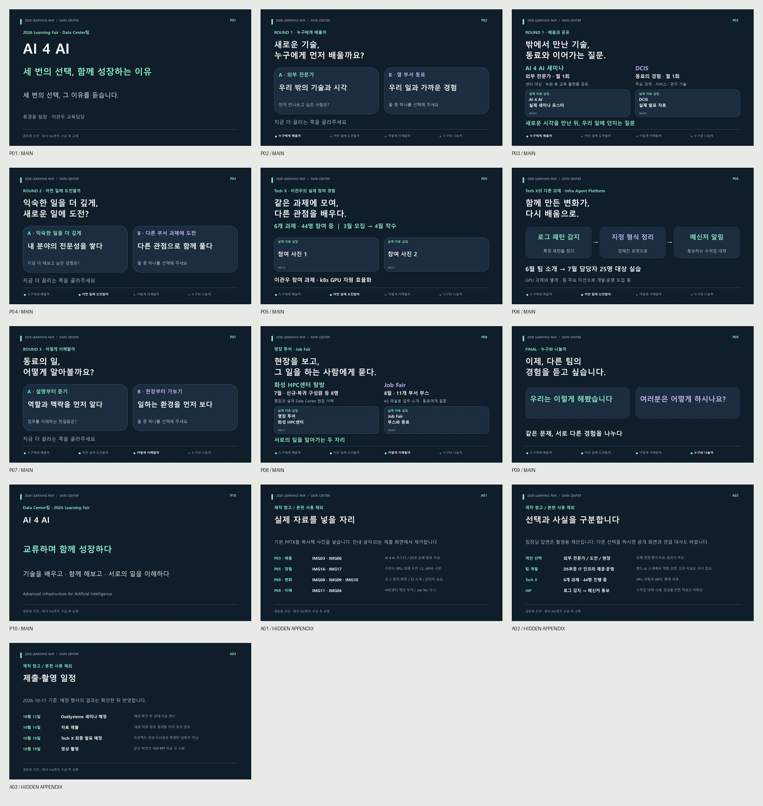

# 2026 Learning Fair — AI 4 AI

> 이 문서에서 해야 할 일: 현재 제작본의 PPT·대본·콘티를 함께 검토하고, 사진 삽입·리허설·촬영을 준비한다. AI 작업자는 [공통 지침](CLAUDE.md)을 먼저 읽는다.

**현재 검토본: balance-v03 — 세 번의 선택, 함께 성장하는 이유.** 사용자가 제공한 [공유 대화의 마지막 방향](https://chatgpt.com/share/6acb6921-8494-83e8-b52c-0a51e1b1261a)을 바탕으로 자료와 대본을 다시 만들었다. 류경동 팀장과 이관우 교육담당이 세 번의 밸런스 게임을 통해 교류하며 성장하는 문화를 소개한다.

## 자료와 촬영 문서

| 자료 | 파일 |
| --- | --- |
| 발표 자료 | [PPTX](deliverables/balance-v03/learning-fair-2026-balance-v03.pptx) · [PDF](deliverables/balance-v03/learning-fair-2026-balance-v03.pdf) |
| 촬영 문서 | [대본](docs/balance-v03/02-script.md) · [콘티](docs/balance-v03/01-storyboard.md) · [프롬프터](deliverables/balance-v03/teleprompter.txt) |
| 선택 전·A·B 화면 | [PPTX 9장](deliverables/balance-v03/choice-states.pptx) · [PDF](deliverables/balance-v03/choice-states.pdf) |
| 제작 준비 | [자료 삽입·선택 변경·영상팀 전달](docs/balance-v03/04-handoff.md) · [리허설 CSV](deliverables/balance-v03/rehearsal.csv) |
| 검증 | [시간 추정](deliverables/balance-v03/timing-report.json) · [파일 검증](deliverables/balance-v03/validation-report.json) |



## 이야기와 시간

**누구에게 배울까 → 어떤 일에 도전할까 → 동료의 일을 어떻게 이해할까 → 다른 팀과 무엇을 나눌까.** 각 질문의 선택 이유를 듣고 실제 세미나·참여 경험·업무 변화·교류 장면으로 이어진다. 우승자를 정하지 않으며, 팀장님의 선택은 촬영용 제안이다.

회사 오프닝 5초 → 스튜디오 오프닝 20초 → 별도 AI 팀 소개 15초 → 나머지 본편 255초 → 회사 클로징 5초, 총 **300초**다. 본편은 10장·275초이며 검토용 숨김 부록은 3장이다. 선택 화면은 본편 장면 안에서 교체한다.

IAP는 25초의 업무 변화 사례다. 이관우의 GPU 과제와 다른 Tech X 과제임을 명시하고, 소개·실습을 통해 나눈 과정도 담았다. 첫 질문에서는 두 출연자가 다른 선택을 하며 마지막에는 다른 팀의 경험을 듣고 싶다는 초대로 마무리한다.

## 준비할 것

현재 사진 삽입 전 PPT·대본·콘티를 준비했다. 영문·숫자의 발음을 환산하고 호흡을 포함한 느린 발화 추정은 고정 영상 포함 **265.87초**다. 실제 리허설은 아직 하지 않았다. 선택·사진·전환을 포함한 편집 목표는 300초다.

1. 두 출연자의 말투·실제 선택을 확인하며 리허설한다. 선택이 바뀌면 대사·공개 큐·화면을 함께 갱신한다.
2. 실제 사진을 별도 PPTX 사본에 넣는다. **IMG16·IMG17 개인 참여 사진은 P05**이며 아직 미수급이다.
3. 10/11 기준 **OutSystems 10/12 예정 → 자료 제출 10/14 → Tech X 발표 10/16 예정 → 촬영 10/19**다. 진행 확인 후 필요한 상태만 갱신한다.
4. 회사 KV·오프닝·클로징과 15초 AI 소개 영상을 준비한다. AI 소개는 브리프만 있으며 영상 파일은 없다.

## 공통 기준과 이전 참고본

- [CLAUDE.md](CLAUDE.md): 현재 이야기·수정·시간·Git 지침
- [확인된 사실과 원본](docs/03-facts-and-assets.md): 프로그램·일정·IMG01–IMG17
- [15초 AI 소개 브리프](docs/07-ai-intro-brief.md): 00:25–00:40 별도 영상
- [외부 참고자료](docs/04-web-references.md): 이전 안의 배경 조사. 새 본편에는 시장 투자 자료나 외부 사진을 사용하지 않음

[story-v02](docs/story-v02/04-handoff.md) / [worldcup-v02](docs/worldcup-v02/04-handoff.md)는 이전 참고본으로 남겨두었다. 각 안의 문서와 발표 자료는 해당 버전 안에서만 사용한다.

## 생성·렌더·검증

```bash
# 최초 설치. 기존 .venv가 있으면 생략한다.
uv venv .venv
uv pip install --python .venv/bin/python -r requirements.txt

# 현재 제작본만 생성·검증한다.
.venv/bin/python scripts/build_balance.py
bash scripts/render_balance_slides.sh
.venv/bin/python scripts/validate_balance.py
```

현재 원본은 `content/balance-v03-film.json`이다. 생성 문서를 직접 고치지 않는다. 렌더는 WSL과 Windows Microsoft PowerPoint가 필요하다. 검토 PDF·1600×900 PNG에는 숨김 부록도 포함한다. 다른 환경에서는 PowerPoint에서 같은 출력 위치로 직접 내보내고 검증한다.

이전 두 안을 재생성해야 할 때만 `build_story_pair.py` → `render_story_pair_slides.sh` → `validate_story_pair.py`를 사용한다. 사용자 사진을 넣은 제출 사본은 자동 출력과 별도 보관한다. 변경은 기존 원격 이력을 보존하며 `main`에 커밋·푸시한다.
