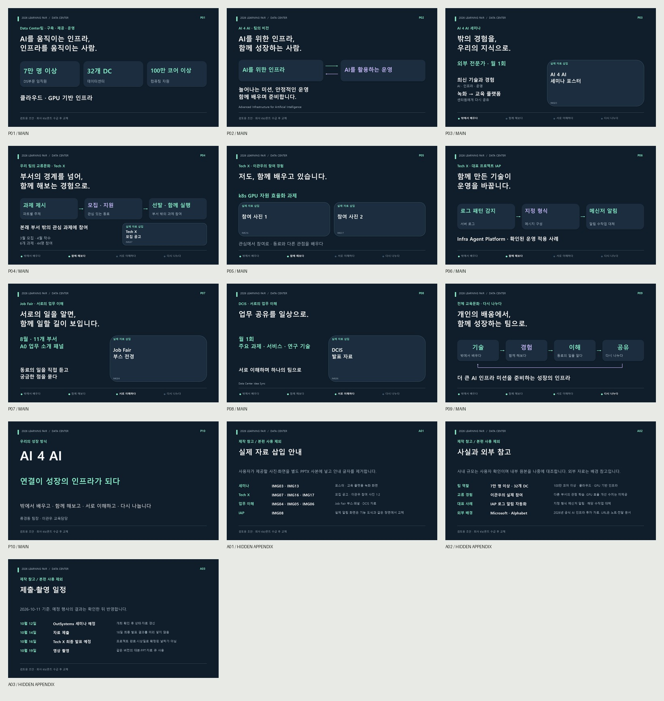

# 2026 Learning Fair — AI 4 AI

> 이 문서에서 해야 할 일: 검토할 제작본의 PPT·대본·콘티를 함께 열고, 자료 삽입·리허설·촬영을 준비한다. AI 작업자는 [공통 지침](CLAUDE.md)을 먼저 읽는다.

Data Center팀 교육문화의 핵심은 **외부 기술과 동료의 경험을 나누며 함께 성장하는 것**이다. 출연자는 류경동 팀장·이관우 교육담당이다. 전문 영상팀이 촬영·편집한다.

현재 제작본은 **story-v02 / worldcup-v02 두 개**다. 사용자 정리 지시에 따라 이전 콘셉트·제작본·중복 지침을 현재 작업 트리에서 제거했다. 이전 작업은 Git 이력에서 찾을 수 있다. 현재 추천은 흐름형이며 최종 제출 형식은 미선택 상태다.

## PPT·대본·콘티

| 제작본 | 자료 | 촬영 문서 | 준비 안내 |
| --- | --- | --- | --- |
| **흐름형 story-v02 · 추천** | [PPTX](deliverables/story-v02/learning-fair-2026-story-v02.pptx) · [PDF](deliverables/story-v02/learning-fair-2026-story-v02.pdf) | [대본](docs/story-v02/02-script.md) · [콘티](docs/story-v02/01-storyboard.md) | [자료 삽입·흐름·촬영](docs/story-v02/04-handoff.md) |
| **월드컵 worldcup-v02 · 대안** | [PPTX](deliverables/worldcup-v02/learning-fair-2026-worldcup-v02.pptx) · [PDF](deliverables/worldcup-v02/learning-fair-2026-worldcup-v02.pdf) | [대본](docs/worldcup-v02/02-script.md) · [콘티](docs/worldcup-v02/01-storyboard.md) | [자료 삽입·선택 공개·촬영](docs/worldcup-v02/04-handoff.md) |

월드컵 [선택 전·후 6장 PPTX](deliverables/worldcup-v02/choice-states.pptx) · [PDF](deliverables/worldcup-v02/choice-states.pdf)는 기존 장면의 공개 큐에서 교체한다. 실제 투표 결과가 아닌 촬영용 추천안이다.



## 공통 문서

| 문서 | 확인할 것 |
| --- | --- |
| [CLAUDE.md](CLAUDE.md) | 이야기·문구·디자인·시간·수정·Git 작업의 공통 지침 |
| [사실과 필요한 원본](docs/03-facts-and-assets.md) | 확인된 역할·프로그램·일정과 IMG01–IMG17 |
| [외부 참고와 출처](docs/04-web-references.md) | 공식 배경 자료·외부 사진의 용도와 권리 |
| [15초 AI 소개 브리프](docs/07-ai-intro-brief.md) | 회사 오프닝과 본편 사이의 별도 영상 제작 |

AGENTS.md는 공통 지침으로 안내하는 진입점이다. 별도 인계·콘셉트 비교·버전 목록은 위 문서에 통합했다.

## 현재 상태와 다음 작업

두 안 모두 **본편 275초 + 고정 영상 25초 = 300초**다. IAP는 18초의 Tech X 대표 사례다. 이관우의 GPU 과제 경험과 별개다. PPT 본편 10장·숨김 부록 3장, 실제 PowerPoint PDF·PNG가 있다. [흐름형 검증](deliverables/story-v02/validation-report.json) · [월드컵 검증](deliverables/worldcup-v02/validation-report.json).

발화·호흡·고정 영상의 느린 추정은 흐름형 **262.34초**, 월드컵형 **271.56초**다. 실제 낭독 실측은 아직 없다. 자료·대본·콘티·타임라인은 준비됐으며 실제 촬영·최종 편집은 남아 있다.

1. 사용자와 최종 형식·출연자 말투를 확인한다. 월드컵을 택하면 제안 선택도 확인한다.
2. 실제 사진과 자료를 별도 PPTX 사본에 붙인다. **개인 사진 IMG16·IMG17은 아직 미수급**이며 흐름형 P05 / 월드컵형 P04 자리다.
3. 10/11 기준 **OutSystems 10/12 예정 → 자료 제출 10/14 → Tech X 발표 10/16 예정 → 촬영 10/19**다. 실제 진행 확인 후 필요한 대사·자막·자료를 갱신한다.
4. 각 `deliverables/`의 `rehearsal.csv`에 실측 시간을 기록해 자료 유지 시간과 발화를 맞춘다.
5. 회사 KV·오프닝·클로징 원본과 별도 15초 AI 소개 영상을 준비해 영상팀에 전달한다. AI 소개는 브리프만 있고 영상 파일은 없다.

## 생성·렌더·검증

```bash
# 최초 설치. 기존 .venv가 있으면 생략한다.
uv venv .venv
uv pip install --python .venv/bin/python -r requirements.txt

# 두 제작본을 각 JSON 원본에서 생성·검증한다.
.venv/bin/python scripts/build_story_pair.py
bash scripts/render_story_pair_slides.sh
.venv/bin/python scripts/validate_story_pair.py
```

`uv`가 없으면 `python3 -m venv .venv`, `.venv/bin/python -m pip install -r requirements.txt`를 사용한다. 생성 코드는 `scripts/presentation_common.py`와 `scripts/production_common.py`의 공통 함수를 사용한다.

렌더는 WSL과 설치된 Windows Microsoft PowerPoint가 필요하며 순서대로 실행한다. 다른 환경에서는 각 PPTX를 같은 폴더의 PDF와 `preview/slide-01.png`부터 **1600×900 PNG**로 내보낸다. 월드컵 선택 화면은 `choice-states.pdf`와 `choice-preview/slide-01.png`부터 6장이다. 검토 PDF·PNG에는 숨김 부록도 포함한다. 렌더할 수 없으면 새 수정본의 화면 검증 한계를 명시한다.

실제 사진을 넣은 제출 사본은 생성 명령으로 덮어쓰지 않는다. 작업 결과는 기존 원격 이력을 유지하며 `main`에 커밋·푸시한다.
