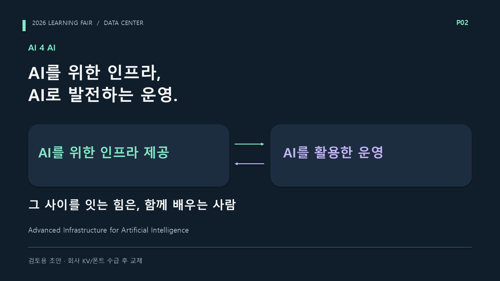
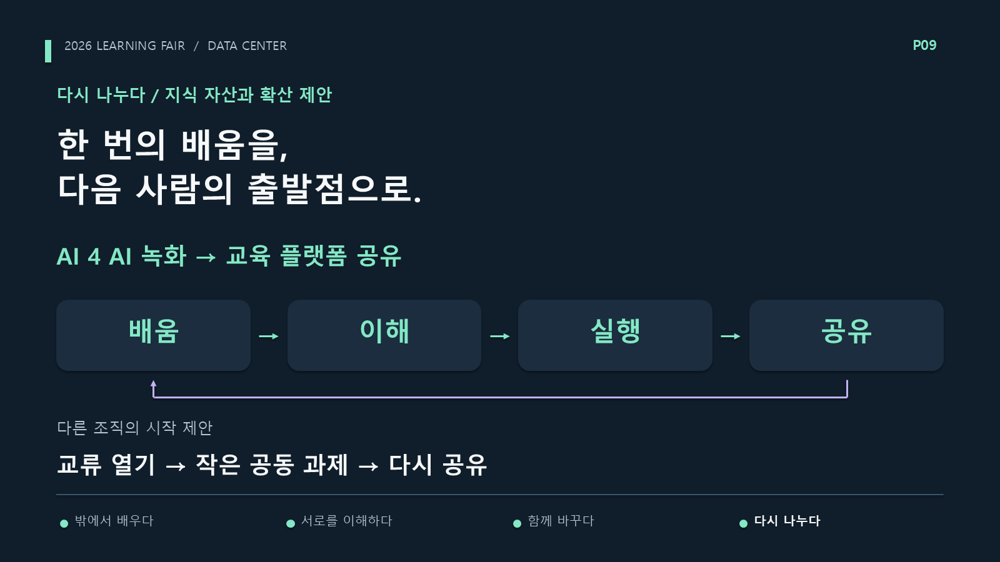

# 전체 제작본 비교와 기준본 재선정

> 이 문서에서 해야 할 일: 버전별 장점과 손실을 비교하고, 다음 수정의 기준을 초안의 서사·화면 구조로 고정한다. 현재 PPT·대본은 덮어쓰지 않는다. 개정할 때는 후속판에서 검증된 사실과 경험만 선별하고 전체 흐름이 좋아졌는지 먼저 확인한다.

**검토일:** 2026-10-11. 사용자는 지금까지 가장 좋은 자료로 `learning-fair-2026.pptx`를 지목했다. 제작본 7종의 실제 PowerPoint 렌더·PPT 텍스트·대본·콘티·원본을 비교한 결과, **전체 서사와 화면 구성의 기준본으로 초안을 선택한다.** 최신 생성본이라는 이유로 v05를 가장 좋은 자료로 간주하지 않는다.

이번 작업은 비교 검토다. 새 PPT·촬영 대본을 생성하거나 기존 제작본을 수정하지 않았다. 평가는 제작자의 판단이며 시청자 조사·출연자 낭독 결과가 아니다.

## 확인한 자료

- 기본본, 월드컵본, 공동 해설 v01·v02·v03·v04·v05: 각 본편 10장·부록 3장, 총 91장. 실제 렌더 전체 미리보기와 장표·노트의 텍스트, 해당 대본과 원본을 비교했다.
- 월드컵 선택 전·후 PPTX 2장: 선택 상태를 보여주는 보조 자료이며 별도의 이야기 대안으로 세지 않았다.
- [발표자 검토](10-presenter-review.md), [모션 검토](11-motion-review.md), [디자인 사례](12-design-concept-references.md), [선택형 진행](13-selection-show-format.md), [방송 형식](15-broadcast-format-recommendations.md), [유튜브 비교](16-youtube-format-comparison.md), [형식 판단](17-format-decision.md), 월드컵 [흐름 검토](worldcup/05-storyline-review.md)·[개정 제안](worldcup/06-storyline-revision-proposal.md).
- 오픈 스튜디오·협동 플레이·배움의 기록 시안과 IAP 모션 시안. 일부는 제안만 존재하며 완성 제작본과 구분했다. 이번 비교에서 외부 영상이나 웹 출처를 새로 열람하지 않았다.

## 버전별 판단

| 버전 | 잘된 점 | 전체 흐름에서의 한계 | 가져올 것 |
| --- | --- | --- | --- |
| **초안 기본본** | 팀 역할과 성장 질문 → AI의 두 방향 → 외부 배움 → 동료 이해 → 공동 실행 → 재공유 → 타이틀 회수. 화면에도 같은 구조가 이어짐 | IAP 기능·소개·실습이 73초·두 장표로 큼. 160명 강조와 일부 수사적인 문구는 현재 지시에 맞춰 조정 필요 | **전체 이야기·의미별 묶음·설명 도식·진행표·결말을 기준으로 채택** |
| 월드컵 | 익숙한 대진표와 두 사람의 선택 이유가 다음 화면에 대한 궁금증을 만듦 | 서로 보완하는 학습 활동에 승리·탈락을 붙임. 내용의 발전보다 경기 규칙이 순서를 결정 | 선택 이유를 서로 듣는 태도. 대진·우승 설정은 중심 형식에서 제외 |
| 공동 해설 v01 | 말이 구체적이고 IAP를 35초로 통합 | Job Fair·DCIS·Tech X·IAP 뒤에 AI 4 AI가 등장해 주제가 뒤늦은 별도 항목으로 보임. 결말이 AI 인프라 역할을 충분히 회수하지 못함 | 짧고 구체적인 설명과 화자 역할 |
| 공동 해설 v02 | 이관우의 GPU 과제 참여 경험, 모집 방식, 자료 삽입 위치가 구체적 | 모집 시기·선발 방식이 장면의 중심을 차지함. 내용은 충실해졌지만 프로그램 설명 순서는 유지 | **실제 개인 경험과 확인된 운영 사실** |
| 공동 해설 v03 | 팀 역할과 교육문화의 핵심을 먼저 제시하고 AI 4 AI를 앞쪽에 배치 | Job Fair·DCIS·모집·개인 경험을 독립 장표로 나눔. 단계는 상단에 적혔지만 이야기의 큰 묶음과 회수가 약함 | 도입의 정확한 팀 역할과 문화 설명 |
| 공동 해설 v04 | AI 인프라·운영과 교류를 직접 연결하려고 함 | ‘지원·활용·배움’을 반복해 연결을 설명문으로 강제함. 제목이 길고 부자연스러워짐 | 연결해야 할 관계 자체. 실제 문구와 반복 방식은 제외 |
| 공동 해설 v05 | 짧은 제목과 구어 대본은 읽기 편해짐 | 진행표·관계 도식·전체 회수가 사라져 항목별 소개에 가까움. 녹화 공유 다음에 Tech X 참여·시상 규칙으로 돌아감. ‘함께 쌓는 전문성’은 초안의 팀 고유한 비유보다 일반적 | 자연스러운 개별 표현. **전체 구성의 기준으로 채택하지 않음** |

## 초안이 더 좋은 구체적인 이유

### 질문과 팀 역할이 교육문화의 이유를 만든다

초안 P01의 “AI를 움직이는 인프라, 인프라를 움직이는 사람.”과 “우리 자신은 어떻게 성장해야 할까요?”는 팀의 일을 소개하면서 다음 이야기를 듣게 만든다. 후속판은 도입에 결론을 먼저 넣고 행사 설명으로 들어가는 경향이 강해졌다.

P02의 “AI를 위한 인프라, AI로 발전하는 운영.”은 이번 팀의 고유한 맥락이다. 두 역할 사이에 함께 배우는 사람을 두면서 AI 4 AI·교류·성장의 관계를 화면으로 설명한다. v04의 긴 당위문보다 전달력이 좋다.

AI 4 AI의 공식 확장명과 실제 외부 세미나 의미는 유지한다. 초안 대사의 “그 연결의 이름이 AI 4 AI”는 모든 활동의 공식 이름으로 읽힐 여지가 있으므로 개정 시 조정한다.

### 활동을 학습 행동으로 묶는다

초안은 ‘밖에서 배우다 / 서로를 이해하다 / 함께 바꾸다 / 다시 나누다’를 큰 묶음으로 사용한다. Job Fair와 DCIS는 동료의 업무를 이해하는 두 방식으로 한 장에 들어간다. Tech X는 ‘이해에서 함께 해보는 경험으로’ 넘어가는 장면이다.

최근판은 각 프로그램과 운영 정보에 독립 장표를 주었다. 특히 ‘옆 부서의 일 → 우리 부서의 요즘 → 부서를 넘는 프로젝트’는 개별 제목으로는 괜찮지만, 한 이야기를 따라가는 표지가 부족하다. 문장을 짧게 만드는 작업만으로 나열감이 해결되지 않았다.

네 단계는 교육문화를 설명하는 구조다. 행사 발생 순서나 검증된 인과를 뜻하지 않는다. Job Fair가 Tech X를 시작하게 했거나 특정 세미나가 IAP를 만들었다고 쓰지 않는다.

### 그림이 관계를 설명한다

초안에는 AI 인프라·운영의 양방향 관계, IAP 기능 단계, 현재 위치를 알려주는 공통 진행표, 문화의 순환이 있다. 최근판은 대부분 제목·사실·사진 삽입 영역으로 통일되어 관계를 보여주는 그림이 줄었다.

핵심은 네이비 색을 다시 쓰는 것만이 아니다. 같은 밝은 바탕에서도 이 구조를 살릴 수 있다. 모든 장에 더 많은 도형을 넣을 필요도 없다. 역할·참여·공유의 관계를 설명하는 장에 필요한 그림을 남긴다.

### 마지막이 앞의 내용을 회수한다

초안 P09는 녹화 공유를 ‘한 번의 배움을 다음 사람의 출발점으로’ 연결한다. 배움·이해·실행·공유를 다시 보여주고, 다른 조직도 시작할 수 있는 방식으로 넓힌다. P10의 ‘연결이 성장의 인프라가 되다’는 처음의 인프라 역할을 교육문화로 회수한다.

v05 P09는 Tech X의 자발적 참여·성과 인정에 집중한다. 사실은 유효하지만, 공유까지 온 이야기에서 다시 한 프로그램의 운영 규칙으로 돌아간다. 운영 방식은 Tech X 설명이나 부록에 놓고 결말은 전체 문화에 사용해야 한다.

## 이후 수정에서 지킬 기준

1. **초안의 구조를 출발점으로 삼는다.** 질문 → AI의 두 역할 → 배움·이해·공동 실행·재공유 → 성장의 인프라라는 회수를 유지한다. 자료마다 별도 프로그램이 시작되는 느낌을 줄인다.
2. **초안의 부족한 사실과 비중을 보완한다.** DS부문의 모든 인프라 책임·AI 운영 효율화를 도입에 명시하고 160명 강조를 뺀다. 교육문화의 핵심도 사례 전에 짧게 말한다.
3. **이관우의 실제 참여 경험을 공동 실행 구간에 넣는다.** GPU 과제 관심 → 자발적 지원 → 다른 부서의 관점을 배운 경험은 후속판에서 얻은 가장 좋은 내용이다. GPU 성과 수치나 미제공 에피소드는 넣지 않는다.
4. **IAP는 대표 사례 35초로 통합한다.** 기능과 소개·실습을 함께 담는다. 초안의 73초를 그대로 복원하지 않는다. IAP로 도입하거나 모든 활동을 IAP의 배경으로 만들지 않는다.
5. **운영 세부 정보가 큰 흐름을 밀어내지 않게 한다.** 3월 모집·4월 착수·선발·시상 방식은 참여를 설명하는 근거다. 독립 장의 주제가 되어 앞뒤 연결을 끊지 않게 배치한다.
6. **제목 길이보다 정확한 표현과 연결을 먼저 본다.** 모든 제목을 명사형으로 줄일 필요는 없다. 팀 고유의 뜻을 담은 짧은 문장은 남기고, 추상적 당위문·중복 문구만 고친다.
7. **추가 방송 설정을 중심에서 내려놓는다.** 월드컵·PICK·상담소·협동 플레이의 진행 규칙을 다시 도입하지 않는다. 오픈 스튜디오는 자료를 보여주는 배치 참고로만 남긴다. 편집은 실제 자료를 읽는 홀드와 필요한 관계 강조에 집중한다.

초안의 [PPTX](../deliverables/learning-fair-2026.pptx)·[PDF](../deliverables/learning-fair-2026.pdf)·[대본](06-script.md)·[콘티](05-storyboard.md)를 한 묶음으로 확인한다. **이 파일들은 당시 초안 그대로 보존한다.** 위 수정 항목이 이미 반영된 파일이 있다는 뜻은 아니다. 다음 제작본을 만들 때 별도 경로에서 적용하고, 다시 전체 흐름을 비교한다.

## 이번 검토에서 바로잡은 판단

후속 개정은 개별 피드백을 해결하는 데 집중하면서 초안의 설명 구조를 잃었다. 문구가 자연스러워지고 사실이 많아진 것을 전체 영상의 개선으로 간주한 판단이 부족했다. 구조·화면·대본의 합으로 보면 초안이 가장 좋은 기준이다. 이후에는 부분 교정 뒤에도 처음 질문에 답하고 마지막에 회수되는지 확인한다.
